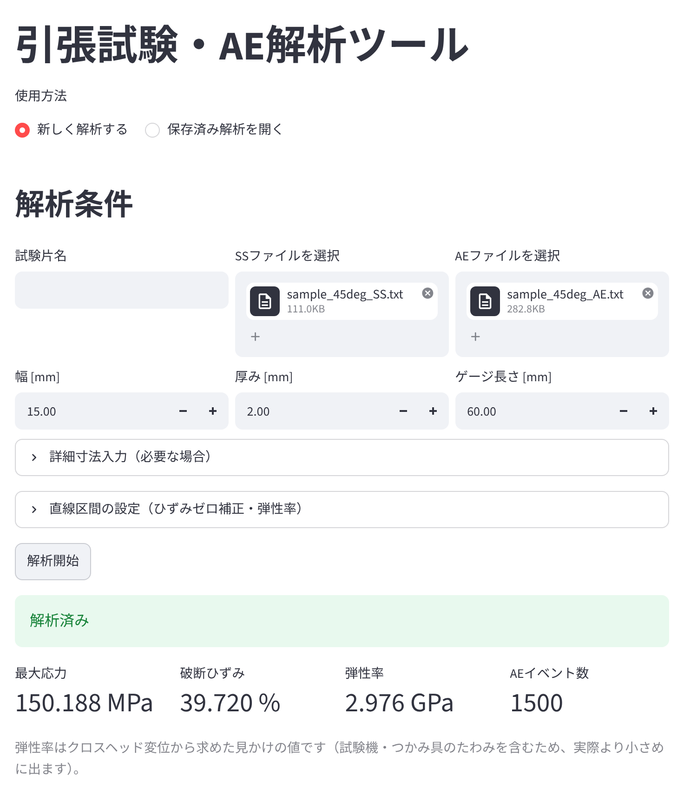
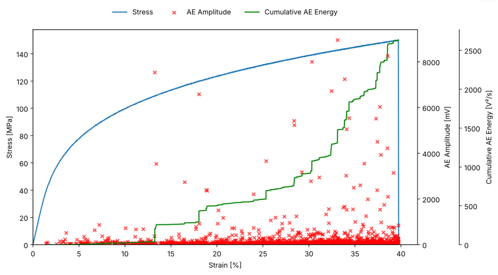
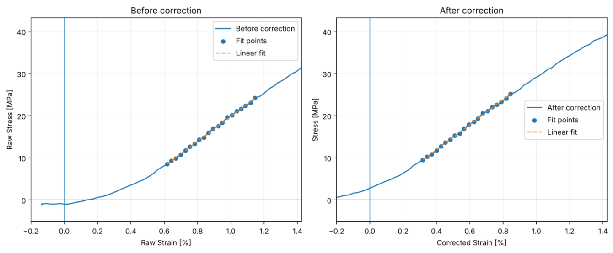

# tensile-test-analyzer

引張試験と AE（アコースティック・エミッション：材料の損傷に伴って生じる微小な音波）計測のデータを解析する Web アプリです。

計測装置から出力した2つのテキストファイル（荷重と変位を記録した SS ファイル、AE が発生した時刻や振幅などを記録した AE ファイル）をアップロードし、試験片の寸法を入力するだけで、応力-ひずみ曲線に AE を重ねたグラフや、最大応力・破断ひずみ・弾性率などが得られます。

研究室で Excel を使って手作業で行っていた解析を、自動化するために作りました。





画像はサンプルデータです

## 主な機能

- 荷重と変位のゼロ点の自動補正
- 最大応力・破断ひずみ・弾性率の自動計算
- 応力-ひずみ曲線に AE（振幅・ピーク周波数・累積 AE エネルギー）を重ねたグラフ。横軸は、ひずみ・時間・変位から選択
- 試験片ごとの Excel 出力（グラフと、補正前後のデータ）

個人用（Google の設定が必要）

- 試験片の一覧表：試験片ごとの寸法と解析結果を、Google スプレッドシートで管理
- 元のファイルの保存：解析に使ったファイルを Google ドライブに保存し、あとで解析し直せる

## 解析の方法

- **荷重のゼロ点**：計測装置の荷重の記録には、試験前からずれがあります。試験前のばらつきから荷重が立ち上がった点を自動で判定し、それより前の平均を 0 N としています。
- **変位のゼロ点（トウ補正）**：引張初期は、つかみ具へのなじみにより、荷重がゆるやかに立ち上がります。荷重-変位曲線の初期の直線部分を延長し、荷重 0 と交わる点を変位の 0 として、曲線全体を平行移動しています。直線部分には、決定係数（R²）が 0.99 以上の区間のうち、傾きが最も大きい区間を自動で選んでいます。ASTM D638 などで使われるトウ補正の考え方です。
- **弾性率**：初期の直線部分の傾きから求めています。変位はクロスヘッド変位を用いているため、つかみ具などのたわみを含む見かけの値です。
- **AE の時間合わせ**：AE データを、ひずみを目印にして SS データの時間にそろえ、応力-ひずみ曲線に重ねています。



ゼロ点補正の確認画面（左：補正前、右：補正後。点は、直線部分として選んだ区間）

## 使った技術

Python、Streamlit、pandas、matplotlib、openpyxl、Google スプレッドシート・ドライブとの連携、Streamlit Community Cloud

## 開発について

研究で使っているアプリを、公開用に整理したものです。普段の開発と運用は、非公開のリポジトリで行っています。

コードは生成 AI（Claude Code）を用いて作成しました。私は主に次を担当しました。

- 機能の検討（研究室のメンバーの要望も反映）
- AI への実装と修正の指示
- 試験データを用いた動作確認

## 動かし方

```
python -m pip install -r requirements.txt
python -m streamlit run app.py
```

Google との連携を使う場合は、Streamlit の Secrets に設定が必要です。
